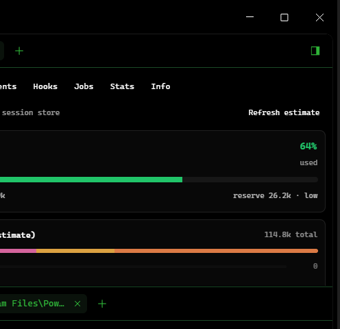
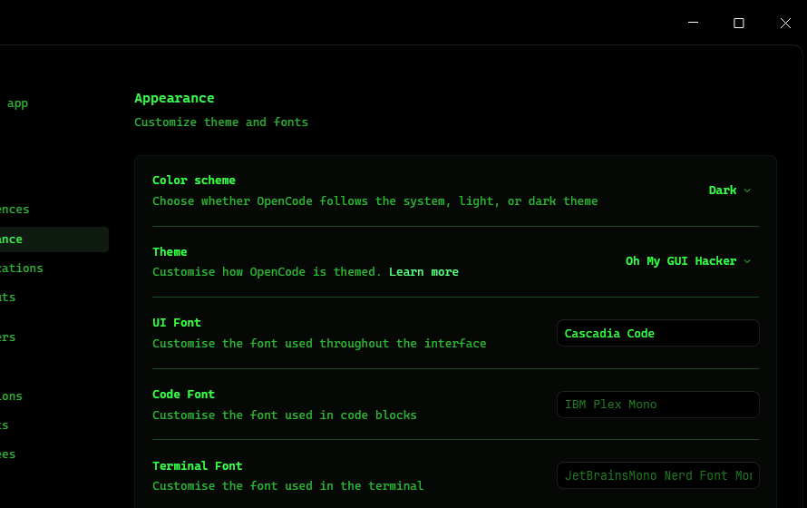

# @involvex/oh-my-gui

OpenCode Desktop session dashboard: live context, agents, hooks, jobs, workspace stats, and info — plus composer pills, Appearance themes, and native View / Help menu items.

Built with the experimental [GUI plugin SDK](https://opencode.ai/docs/build/plugins/gui/) (`./gui-experimental`).

**Requires OpenCode Desktop / `@opencode/plugin` ≥ 2.3.2.**

## Installation

Add to your `opencode.jsonc` (Desktop) or `opencode.json`:

```json
{
	"$schema": "https://opencode.ai/config.json",
	"plugins": [{ "package": "@involvex/oh-my-gui@latest" }]
}
```

OpenCode installs the plugin on next launch. V2 shape is `{ "package", "options" }` (not the old `["pkg", opts]` tuple).

This plugin does **not** open its own HTTP socket — OpenCode's service / `opencode serve` does. Configure hostname and port with `opencode service set` or a top-level `server` block. Optional plugin `hostname` / `port` / `url` values are only for your own tooling; leave `contributeServer` false (default).

### Load from source

```bash
bun run setup
```

Installs deps if needed, then adds this package to `~/.config/opencode/opencode.json` via an absolute `file:///` path. Restart OpenCode Desktop afterward.

```bash
bun run unregister
```

## Screenshots





## GUI surfaces

Contributions follow the Desktop GUI registries from the [GUI docs](https://opencode.ai/docs/build/plugins/gui/).

### Side panel

`Panel` with `region: "side"` (default width 380px; drag the divider to resize).

| Open with                   | Notes                         |
| --------------------------- | ----------------------------- |
| Session panel menu          | **Oh My GUI**                 |
| `Ctrl+\``                   | Toggle                        |
| `/omg`                      | Slash command                 |
| **View → Toggle Oh My GUI** | Native menubar (main process) |

Tabs: **Context**, **Agents**, **Hooks**, **Jobs**, **Stats**, **Info**. Auto-open on new session tabs is on by default (Settings → Oh My GUI).

### Composer pills

| Pill    | When                                                                                       |
| ------- | ------------------------------------------------------------------------------------------ |
| Context | Live tokens, cost, and window from the session store; shows **Compacting…** during summary |
| Commit  | Uncommitted changes in the session repo — click sends `/commit`                            |
| Jobs    | Background shell / subagent / image / codemode work                                        |
| Waiting | Permissions, forms, or stranded / queued prompts                                           |

### Themes

`Theme` entries in **Settings → Appearance → Theme** (desktop theme schema `https://opencode.ai/desktop-theme.json`):

- **Oh My GUI**
- **Oh My GUI Dawn**
- **Oh My GUI Hacker**
- **Oh My GUI Hacker AMOLED**

### Code block action

**Run in terminal** on `sh` / `bash` / `powershell` / `cmd` fences (`CodeBlockAction`).

### Settings and app menu

- **Settings → Oh My GUI** — tabs, pills, notifications, poll interval, context warning threshold, auto-open.
- **View** — toggle panel and jump to each tab.
- **Help → Copy Oh My GUI Diagnostics** — sanitized store snapshot for support.

## What’s in the dashboard

**Context & jobs** — Context pill and Context header use the Desktop session store (`lastAssistantWithUsage`, model limits, `session.cost`), same source as the app header. Provider tokens include cache read and cache write. Compaction progress and summary cost show while / after a summary. Jobs list live `session.background` work and, when available, `experimental.job.list` history. Optional desktop notifications when a watched job finishes (including unfocused sessions).

**Live store (Info / Agents)** — Branch from `location.vcs`, MCP from `location.mcp.server`, children from `session.family`, goal from `opencode.goal` when that plugin is present. **Provider allowance** on Context when `location.usage.limits` reports OpenCode Go meters or Console budgets. Hook log keeps tools, forks, compaction, and shell start/end (no catch-all `event:*` flood).

**Workspace stats** — Stats tab calls `session.stats` (fallback `experimental.session.stats`) for Today / 7 days / 30 days with tool detail: session and prompt counts, cost, tokens, models, tools, activity. Workspace-scoped (optionally filtered by project), not a per-session store read.

**Other** — Quote a hook row into the composer; fork parent with **Open** on Info; Waiting pill focuses the Info waiting list.

## Development

```bash
bun install
bun run build:gui    # emits dist/gui-experimental.cjs (required for Desktop)
bun run dev:gui      # vite build --watch; Desktop reloads the GUI
bun typecheck
bun dev              # OpenCode CLI with the server plugin from source
```

### Layout

```
src/
  index.ts           # Server plugin (hooks + DashboardRpc)
  gui.tsx            # Desktop GUI entry (setup + main)
  gui/
    definition.ts    # stores, i18n
    window.tsx       # Panel, pills, themes, settings, commands
    main.ts          # MenubarItem (View / Help)
    *.tsx            # tab views
dist/gui-experimental.cjs
```

## Publishing

```bash
npm publish
```

## Resources

- [GUI plugins](https://opencode.ai/docs/build/plugins/gui/)
- [Plugins](https://opencode.ai/docs/build/plugins)
- [SDK](https://opencode.ai/docs/sdk)
- [Ecosystem](https://opencode.ai/docs/ecosystem/#plugins)
- [OpenCode Discord](https://opencode.ai/discord)
- [Repository](https://github.com/involvex/opencode-oh-my-gui)

## License

MIT
